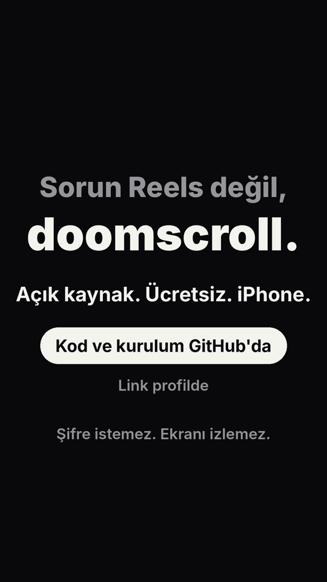
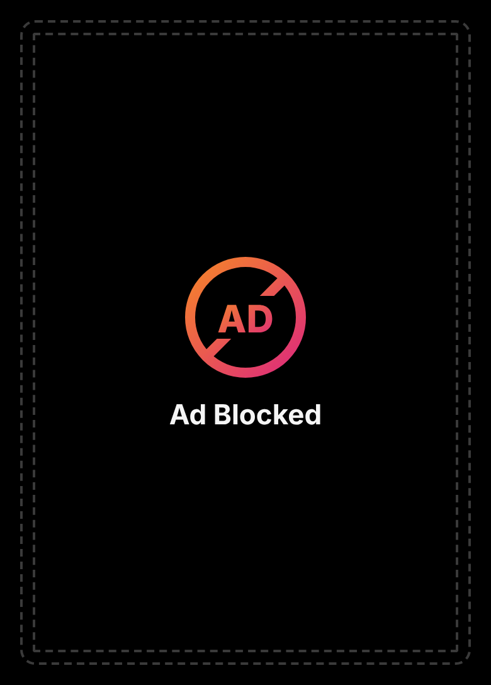

# No Doomscroll for Insta

https://github.com/user-attachments/assets/f354e2bb-8c18-4999-9b3a-19a457ff8ed0

**[Türkçe](#türkçe) · [English](#english)**

  
   
  <a href="docs/reelsiz-tanitim.mp4"><b>▶ Videoyu izle / Watch the video</b></a>

---

## Türkçe

### Sorun Reels değil, Doomscroll

Bir Reels izlemek sorun değil. Sorun, bir tanesine dokununca kendini bir saat boyunca aşağı kaydırırken bulman. Bu proje Reels'i yasaklamıyor, sadece seni içine çeken sonsuz kaydırmayı kapatıyor.

### Neler değişiyor

- Reels sekmesi menüden kalkar.
- Akışa düşen bir Reels'i yerinde izlersin ama dokununca seni Reels sayfasına götürmez.
- Arkadaşının DM'den attığı Reels'i izlersin, aşağı kaydırınca sohbete geri dönersin.
- Başka bir platformdan gelen Reels linkini açıp izlersin. Sonrakine geçmeye çalışınca ana sayfaya dönersin.
- Reklamlar gizlenir. Yerinde sade bir "Ad Blocked" alanı kalır, kaydırıp geçersin.

  
- Keşfet'in video duvarı kalkar, arama çalışmaya devam eder.
- Akış, hikayeler, mesajlar, beğeni, yorum ve kaydetme normal çalışır.

### Neden bu yöntem

- Instagram şifreni başka bir uygulamaya vermezsin.
- Ekranın kaydedilmez ya da izlenmez.
- Açık kaynak ve ücretsiz. Ne yaptığını açıkça görebilirsin, gizlimiz yok.
- Instagram Türkçe de olsa İngilizce de olsa çalışır.

### Kurulum (iPhone)

1. Instagram uygulamasını sil. Hesabın silinmez.
2. App Store'dan ücretsiz **Userscripts** uygulamasını kur. Uygulamayı aç ve kodların saklanacağı bir klasör seç.
3. **Ayarlar → Uygulamalar → Safari → Eklentiler → Userscripts**'i aç.
4. [`instagram-reelsiz.user.js`](instagram-reelsiz.user.js) dosyasını indir, **Dosyalar** uygulamasında 2. adımda seçtiğin klasöre kaydet.
5. Safari'de instagram.com'u aç ve giriş yap. Userscripts izin isterse **"Always Allow on This Website"** seç.
6. **Paylaş → Ana Ekrana Ekle**. **"Web Uygulaması Olarak Aç" kapalı olmalı**, aksi halde eklenti çalışmaz.

### Bilinen sınırlar

- Instagram web sitesini haber vermeden değiştirebilir. Bu durumda kodun güncellenmesi gerekir.
- Reklam tanıma, gönderideki "Ad / Sponsored / Sponsorlu" etiketine bakar. Instagram etiketi değiştirirse listeye eklenmesi gerekir.

*Sadece iPhone için test edildi.*

### Lisans

[MIT](LICENSE). Ücretsiz kullanabilir, değiştirebilir ve paylaşabilirsin.

---

## English

### The problem isn't Reels, it's Doomscroll

Watching a Reel isn't the problem. The problem is tapping one and finding yourself scrolling for an hour. This project doesn't ban Reels; it just shuts down the endless scroll that pulls you in.

### What changes

- The Reels tab disappears from the menu.
- Reels in your feed play in place, but tapping them won't take you to the Reels page.
- Reels a friend sends you in DMs play normally; swipe down and you're back in the chat.
- Reels links shared from other platforms open and play; try to swipe to the next one and you're sent to the home feed.
- Ads are hidden. A clean "Ad Blocked" placeholder takes their place, just scroll past.

  
- The Explore video wall is hidden; search still works.
- Feed, stories, messages, likes, comments and saves work as usual.

### Why this approach

- You never give your Instagram password to another app.
- Your screen is never recorded or monitored.
- Open source and free. You can see exactly what it does. Nothing hidden.
- Works whether Instagram is set to English or Turkish.

### Installation (iPhone)

1. Delete the Instagram app. Your account is not affected.
2. Install the free **Userscripts** app from the App Store. Open it and choose a folder to store scripts.
3. Go to **Settings → Apps → Safari → Extensions → Userscripts** and turn it on.
4. Download [`instagram-reelsiz.user.js`](instagram-reelsiz.user.js) and save it to the folder from step 2 using the **Files** app.
5. Open instagram.com in Safari and log in. If Userscripts asks for permission, choose **"Always Allow on This Website"**.
6. **Share → Add to Home Screen**. **"Open as Web App" must be turned off**, otherwise the extension won't run.

### Known limitations

- Instagram can change its website at any time, which may require a code update.
- Ad detection looks for the "Ad / Sponsored / Sponsorlu" label on posts. If Instagram changes the label, it needs to be added to the list.

*Tested on iPhone only.*

### License

[MIT](LICENSE). Free to use, modify and share.
